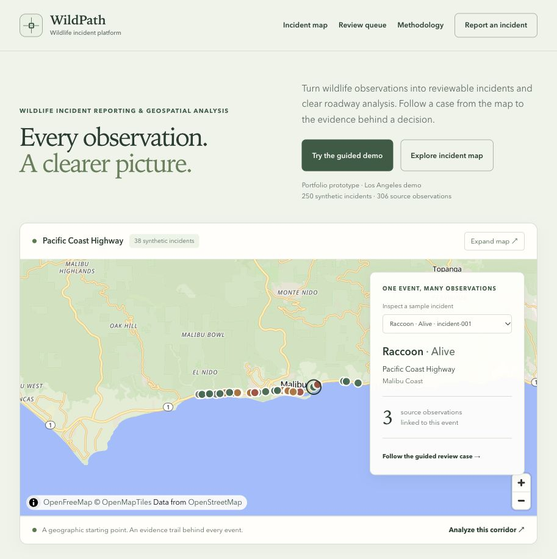
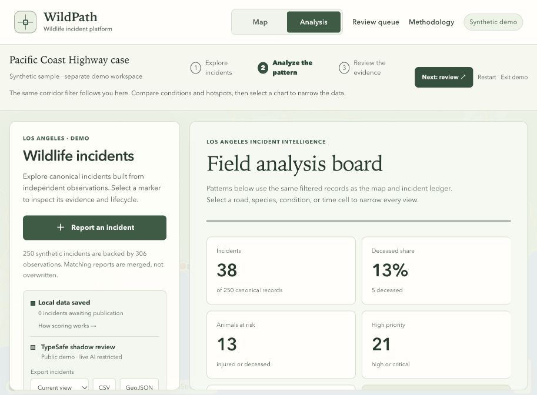

# Binbo Xu

I build data-driven web applications that connect analytical thinking, product workflows, and clear, usable interfaces.

## Featured project · WildPath

**Wildlife incident reporting & geospatial analysis**

WildPath explores how individual wildlife observations can become structured incidents, reviewable evidence, and useful roadway insights. It is an incident-intelligence prototype—not another navigation app.

[Explore the live demo](https://wildpath-web.binboxu0910.chatgpt.site/) · [Read the methodology](https://wildpath-web.binboxu0910.chatgpt.site/methodology)

> The demo is publicly accessible—no password or account is required. The source repository remains private. Reports and review decisions stay in each visitor's browser; live AI calls are restricted to separately authorized server clients.

### From observations to insights

- **One shared analytical state:** filters update the incident map, event list, and analysis together. Explore trends, animal conditions, priority corridors, and weekday/time-of-day patterns; export the selected records as CSV or GeoJSON.
- **Observations are not incidents:** preserve individual source reports while matching nearby, same-species observations to a canonical event. The sample contains **250 synthetic incidents backed by 306 observations**.
- **Traceable human review:** inspect evidence, merge possible duplicates, and record approve/reject decisions with a reason and audit trail. Incidents move through an explicit review and publication lifecycle.
- **Transparent AI boundaries:** deterministic evidence scoring guides review. Optional TypeSafe/Jev judgments run in shadow mode for comparison, without automatically publishing or rejecting reports.
- **A usable end-to-end prototype:** structured reporting, browser-local persistence, a guided case study, and responsive desktop/mobile layouts.

### Product preview

*Explore incidents in geographic context, then follow the evidence behind an event.*

*Descriptive analysis of a synthetic sample—not a prediction of real-world collision risk.*

**Built with:** TypeScript · React · Next.js-compatible Vinext runtime · MapLibre GL JS · OpenFreeMap · Cloudflare-compatible Workers · optional TypeSafe/Jev integration.

**Quality checks:** Automated regression tests, TypeScript checking, linting, and GitHub Actions CI.

**Scope:** This is a personal portfolio prototype using synthetic Los Angeles-area data. Records are stored in each browser, not a shared production database. WildPath does not dispatch responders or contact a wildlife agency.

Basemap attribution: OpenFreeMap / OpenMapTiles / © OpenStreetMap contributors. Screenshots show demonstration data.
